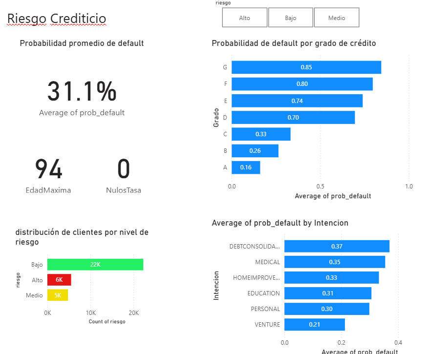

# Proyecto de analisis de riesgo crediticio


## Problema

Las entidades microfinancieras necesitan identificar, antes del desembolso, qué
solicitudes tienen mayor probabilidad de incumplimiento. Revisar manualmente
todas las solicitudes es costoso; no revisar ninguna eleva la morosidad. El
problema es construir un score de riesgo que permita focalizar el esfuerzo
del analista en los casos de mayor probabilidad de default.

## Solución

Pipeline de tres capas:

1. **Python** (`src/train_model.py`): limpieza de datos, entrenamiento de un
   Random Forest y cálculo de la probabilidad de default por solicitante.
2. **SQL Server** (`CreditRiskDemo`): persistencia de los datos limpios con
   scores en la tabla `credit_scores`.
3. **Power BI** (`dashboard/risk_demo.pbix`): dashboard que visualiza la
   distribución de riesgo, el riesgo por grado de crédito y por propósito
   del préstamo.

La limpieza ocurre una sola vez, en la capa de Python. Power BI solo consume
la tabla ya procesada, garantizando que el modelo y el dashboard trabajen
sobre la misma versión de los datos.

## Dataset

[Credit Risk Dataset](https://www.kaggle.com/datasets/laotse/credit-risk-dataset)
(Kaggle). 32,581 registros con variables demográficas y financieras de
solicitantes de crédito. Variable objetivo: `loan_status` (1 = default).

## Limpieza de datos

| Problema                                        | Tratamiento                                                   | Resultado                      |
| ----------------------------------------------- | ------------------------------------------------------------- | ------------------------------ |
| Edades irreales (hasta 144 años)               | Eliminación de registros con `person_age > 100`            | Edad final: 20–94 años       |
| Antigüedad laboral imposible (hasta 123 años) | Eliminación de registros con `person_emp_length > 60`      | Antigüedad final: 0–41 años |
| Nulos en `loan_int_rate` (~9.5%)              | Imputación con la mediana del `loan_grade` correspondiente | 0 nulos en tasa                |
| Nulos en `person_emp_length` (~2.7%)          | Imputación con la mediana global                             | 0 nulos                        |
| Outliers en `person_income`                   | Winsorización al percentil 99                                | Distribución acotada          |
| Desbalance de clases (78% / 22%)                | `class_weight="balanced"` en Random Forest                  | Modelo balanceado              |

Registros finales cargados a SQL Server: **32,574**.

## Modelo

- **Algoritmo**: Random Forest (`n_estimators=200`, `max_depth=12`,
  `class_weight="balanced"`)
- **AUC en test**: **0.9214**
- **Variables más predictivas**: `loan_int_rate`, `loan_percent_income`,
  `loan_grade`, `person_income`, `loan_amnt`

## Resultados y Dashboard



El dashboard desarrollado en Power BI sintetiza los hallazgos clave:

- **Probabilidad promedio de default**: 31.1% en toda la cartera evaluada.
- **Distribución de riesgo**: 22K solicitudes (68.4%) en riesgo Bajo, 5K (14.7%) en Medio y 6K (16.9%) en Alto. El segmento Alto concentra una probabilidad de default del 92%.
- **Riesgo por grado de crédito**: La probabilidad de default escala de forma monotónica desde 0.16 para el grado A hasta 0.85 para el grado G, validando la lógica del negocio.
- **Riesgo por propósito**: Los préstamos para consolidación de deuda (0.37) y gastos médicos (0.35) presentan el mayor riesgo, mientras que los de emprendimiento (0.21) presentan el menor.
- **Auditoría de datos**: Tarjetas de control que verifican la edad máxima (94 años) y 0 nulos en la tasa de interés, demostrando la efectividad del pipeline de limpieza.

### Validación del modelo

La diferencia de 60 puntos porcentuales entre la probabilidad predicha promedio de los clientes que **no** incumplieron (17.8%) y los que **sí** incumplieron (78.6%) confirma la capacidad discriminativa del modelo (AUC 0.9214).

Las consultas SQL que sustentan cada visual están documentadas en
[`src/queries.sql`](src/queries.sql).

## Estructura del repositorio

```text
credit-risk-demo/
├── .env.example
├── .gitignore
├── README.md
├── requirements.txt
├── data/
│   └── credit_risk_dataset.csv
├── src/
│   ├── train_model.py
│   └── queries.sql
└── dashboard/
    ├── risk_demo.pbix
    └── captura.png
```

Pipeline end-to-end para predecir la probabilidad de default en solicitudes de

crédito, con el objetivo de priorizar la revisión manual en los casos de mayor
riesgo. Proyecto de portafolio orientado al área de Riesgos de entidades
microfinancieras.
